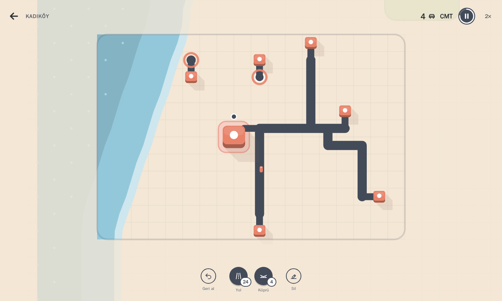
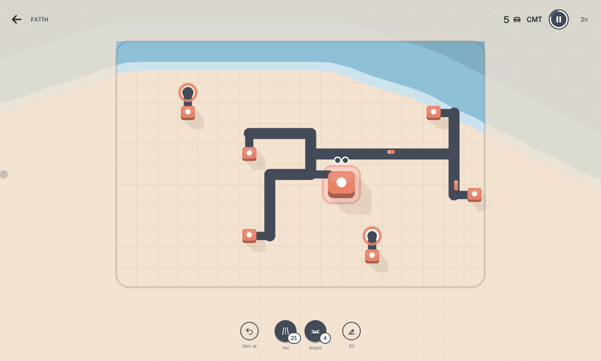

# İstanbul Trafik

İstanbul ilçelerinde yol ağı kurup büyüyen trafiği yönettiğiniz, tarayıcıda çalışan 2D trafik
simülasyonu ve şehir planlama oyunu.

**▶ Hemen oyna: https://alptekinsunnetci.github.io/istanbul-trafik/**

Her iş yerinin bir rengi ve sembolü vardır; aynı renkteki evlerden arabalar oraya gider. Oyuncu
evleri iş yerlerine yolla bağlar. İş yerlerinde bekleyen yolculuklar (raptiyeler) birikir; biri
taşarsa çevresindeki kırmızı halka dolar ve halka tamamen dolunca oyun biter. Skor, tamamlanan
yolculuk sayısıdır. Her hafta yeni yol parçaları gelir ve iki ödülden biri seçilir; şehir büyüdükçe
yeni renkler eklenir.

- **Haritalar:** Kadıköy, Beşiktaş, Üsküdar, Fatih, Şişli, Bakırköy. Her biri ilçenin kıyı ve
  park düzenini sadeleştirilmiş, özgün bir ızgarada yorumlar; binalar gerçek mahalle adlarını taşır.
- **Sunucu gerekmez:** Oyun tamamen istemci tarafında çalışır. Statik dosya sunan herhangi bir
  web sunucusu (Nginx) yeterlidir. Harici API, CDN, hesap veya telemetri yoktur.

## Ekran görüntüleri



| Ana menü                                                    | Fatih: Haliç kıyısı                                             |
| ----------------------------------------------------------- | --------------------------------------------------------------- |
|  |  |

| Beşiktaş: haftalık ödül                                                        |
| ------------------------------------------------------------------------------ |
|  |

## Gereksinimler

Önerilen yol **yalnızca Docker** kullanmaktır; ana makineye Node.js kurmanız gerekmez.

| Araç                           | Sürüm                                               | Not                                                      |
| ------------------------------ | --------------------------------------------------- | -------------------------------------------------------- |
| Docker Engine / Docker Desktop | 24+ (Compose v2 ile)                                | Tüm geliştirme, test ve derleme container içinde çalışır |
| Node.js (isteğe bağlı)         | 22.12+ (container: 22.23.3)                         | Yalnızca Docker'sız çalışmak isterseniz                  |
| npm (isteğe bağlı)             | 10+                                                 | `package-lock.json` ile sabitlenmiş bağımlılıklar        |
| Tarayıcı                       | WebGL destekli güncel Chrome, Edge, Firefox, Safari | Mobil/tablet temel düzeyde desteklenir                   |

## Hızlı başlangıç (Docker)

```bash
# Üretim sürümünü derle ve çalıştır (typecheck + lint + testler imaj içinde çalışır)
docker compose up -d --build web
# → http://localhost:8080
```

## Geliştirme (Docker)

`dev` servisi kaynak klasörünü bağlar; `node_modules` Linux'a özgü olduğu için adlandırılmış bir
Docker biriminde tutulur.

```bash
docker compose run --rm dev npm ci              # bağımlılıkları kur (ilk sefer)
docker compose --profile dev up dev             # Vite geliştirme sunucusu → http://localhost:5173
docker compose run --rm dev npm run typecheck   # TypeScript (strict)
docker compose run --rm dev npm run lint        # ESLint
docker compose run --rm dev npm test            # birim + entegrasyon testleri (Vitest)
docker compose run --rm dev npm run check       # typecheck + lint + biçim + testler
docker compose run --rm dev npm run build       # üretim derlemesi → dist/
docker compose run --rm dev npm run bench       # 15 dakikalık, ~500 araçlı kararlılık/performans testi
docker compose run --rm e2e                     # Playwright tarayıcı testleri (Chromium + mobil)
```

Tarayıcı testleri, sürüm uyumlu Playwright imajında (`mcr.microsoft.com/playwright:v1.63.0-noble`)
çalışır; tarayıcı kurulumu gerekmez. Çalışan bir yayına karşı test etmek için:

```bash
docker compose up -d web
docker run --rm --network istanbul-trafik_default -e E2E_BASE_URL=http://web \
  -v "$PWD:/app" -v istanbul-trafik_e2e_node_modules:/app/node_modules -w /app --ipc=host \
  mcr.microsoft.com/playwright:v1.63.0-noble npx playwright test
```

> Windows'ta Docker Desktop bind mount'larında dosya izleme olaylarını iletmediği için `dev`
> servisi `VITE_USE_POLLING=true` ile çalışır.

## Docker'sız çalışma (isteğe bağlı)

```bash
npm ci
npm run dev          # http://localhost:5173
npm run check
npm run build
npm run preview      # derlenmiş dist/ → http://localhost:4173
npx playwright install --with-deps chromium   # bir kez: tarayıcı ikilisi
npm run test:e2e
```

## Paket komutları

| Komut                     | Açıklama                                                |
| ------------------------- | ------------------------------------------------------- |
| `dev`                     | Vite geliştirme sunucusu                                |
| `build`                   | Üretim derlemesi (`dist/`)                              |
| `preview`                 | `dist/` klasörünü yerelde sunar                         |
| `typecheck`               | `tsc --noEmit` (strict, `noUncheckedIndexedAccess`)     |
| `lint`                    | ESLint (tip bilgili kurallar)                           |
| `format` / `format:check` | Prettier                                                |
| `test` / `test:watch`     | Vitest birim + entegrasyon testleri                     |
| `test:e2e`                | Playwright tarayıcı testleri                            |
| `bench`                   | Uzun süreli performans ve kararlılık testi              |
| `check`                   | typecheck + lint + biçim + test                         |
| `build:prod`              | `check` başarılıysa `build`                             |
| `licenses`                | `docs/THIRD_PARTY_LICENSES.md` dosyasını yeniden üretir |

## Nasıl oynanır?

| Kontrol                                    | İşlev                                              |
| ------------------------------------------ | -------------------------------------------------- |
| Binadan başlayıp diğer binaya sürükle      | Yol çiz; uçlar binaların girişine yapışır          |
| Geri al düğmesi, `Ctrl+Z`                  | Son çizimi geri al, parçalar geri gelir            |
| Sil düğmesi ya da sağ tık + sürükle        | Yolu sil, parçalar geri gelir                      |
| Araca veya binaya dokunma                  | Ayrıntıları göster                                 |
| Tekerlek, `+` / `−`, iki parmakla kıstırma | Yakınlaştır / uzaklaştır                           |
| Orta tık + sürükle, `W A S D`, iki parmak  | Haritayı kaydır                                    |
| `Boşluk`                                   | Duraklat / devam                                   |
| `1` · `2` · `3`                            | Yol · Bulvar · Silgi                               |
| `T` · `I` · `F`                            | Trafik katmanı · İstatistikler · Haritayı sığdır   |
| `Esc` veya ←                               | Menü (istatistik, yeniden başlat, ayarlar, yardım) |

- **Parçalar:** Her kara hücresi 1 yol parçası, her su hücresi 1 köprü parçası kullanır. Bulvar
  (iki şeritli, hızlı yol) mevcut yolun üstüne çizilir ve hücre başına 1 bulvar parçası kullanır.
- Her hafta (90 sn) +20 yol parçası gelir ve iki ödülden biri seçilir (+15 yol, +5 köprü, +10 bulvar).
  Oyun seçim yapılana kadar bekler.
- **Zorluk:** Rahat (oyun bitmez, sakin tempo), Normal (varsayılan) ve Zor. Seçim hatırlanır; en iyi
  skorlar ilçe ve mod başına ayrı tutulur.
- **Oynayarak öğren:** Menüdeki rehberli oyun 4 adımda anlatır; saat ilk yol bağlanana kadar bekler.
- **Büyüyen alan:** Oyun küçük bir alanla başlar (dikey ekranda dikey), her hafta genişler; kamera
  alanı kendiliğinden sığdırır, kaydırma ve yakınlaştırma isteğe bağlıdır.
- Aynı **harita tohumu** aynı başlangıç haritasını ve trafik akışını üretir.

## Mimari özeti

Ayrıntılar: [ARCHITECTURE.md](ARCHITECTURE.md).

```
src/core       sabitler, deterministik PRNG, olay yolu, sabit adımlı simülasyon
src/map        ızgara, yol düzenleyici, topoloji → yönlü yol grafiği, geometri, ilçeler
src/traffic    araç modeli, IDM takip, şerit değiştirme, kavşak rezervasyonu, A* rota, talep, kuyruk
src/gameplay   oturum, skor/memnuniyet, zorluk, oyun sonu, kayıt anlık görüntüsü
src/persistence  sürümlü kayıt şeması, doğrulama, göç, localStorage yöneticisi
src/rendering  PixiJS çizimi (salt okuma): zemin, yollar, binalar, araçlar, efektler, kamera
src/ui         DOM arayüzü: HUD, araç çubuğu, menüler, ayarlar, istatistik, girdi
src/app        giriş noktası, durum makinesi, oyun döngüsü, denetleyici, ses
```

Simülasyon çekirdeği (`core`, `map`, `traffic`, `gameplay`, `persistence`) PixiJS'e ve DOM'a bağımlı
değildir. Bu sınır ESLint kuralıyla zorlanır.

## Kayıtlar

Ayarlar, en iyi skorlar, son 20 oyunun özeti ve devam edilebilir aktif oyun yalnızca tarayıcının
`localStorage` alanında tutulur. **Sunucuya yedeklenmez**; tarayıcı/site verileri silinirse kaybolur.
Bozuk veya uyumsuz kayıtlar uygulamayı çökertmez: güvenli varsayılanlara dönülür ve kullanıcıya bildirilir.

## Bilinen sınırlamalar

- Tek yön motorda desteklenir ama sade arayüzde sunulmaz. Trafik ışıkları yoktur. Kavşaklar çakışma bölgesi rezervasyonuyla "en uzun bekleyen önce" kuralıyla
  yönetilir. Mimari, ışık gibi başka kontrol politikalarının eklenmesine hazırdır (`JunctionPolicy`).
- Bulvar en fazla 2 şerit/yöndür. Şerit değiştirme yalnızca aynı yol parçası içinde yapılır.
  Dönüş için doğru şeride geçemeyen araç, durma çizgisinde son çare olarak yanlış şeritten döner.
- Yol hücreleri ızgaraya bağlıdır (90° dönüşler). Su üzerinde köprü kurulabilir, ancak alt/üst geçit
  (kavşaksız kesişme) yoktur: kesişen yollar her zaman kavşak oluşturur.
- Ses efektleri Web Audio ile sentezlenir; müzik yoktur.
- Performans hedefi (60 FPS) yalnızca headless Chromium'da yazılım (SwiftShader) render ile işlevsel
  olarak denenmiştir; gerçek cihazlarda FPS ölçümü yapılmamıştır. Simülasyon tik süreleri ölçülmüştür
  (bkz. ARCHITECTURE.md → Performans).
- Mobil cihazlar yalnızca Playwright'ın Pixel 7 emülasyonunda test edilmiştir; gerçek cihazda test edilmemiştir.
- Proje adı, logo ve marka uygunluğu araştırılmamıştır; ticari yayından önce ayrıca kontrol edilmelidir.

## Lisans

Kaynak kod: [LICENSE](LICENSE). Üçüncü taraf paketler: [docs/THIRD_PARTY_LICENSES.md](docs/THIRD_PARTY_LICENSES.md).
Tüm oyun görselleri ve sesleri kodla üretilir; harici varlık kullanılmaz.
