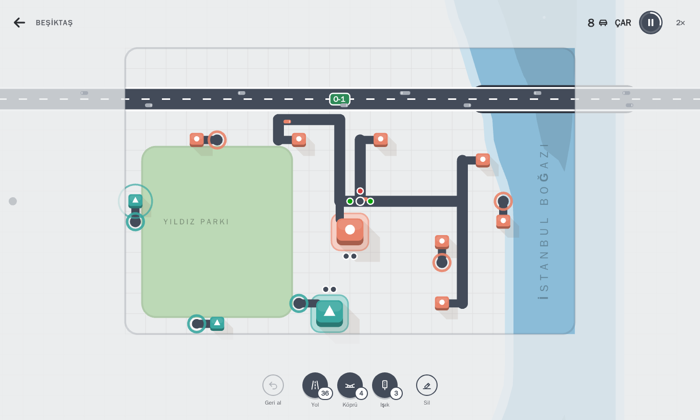
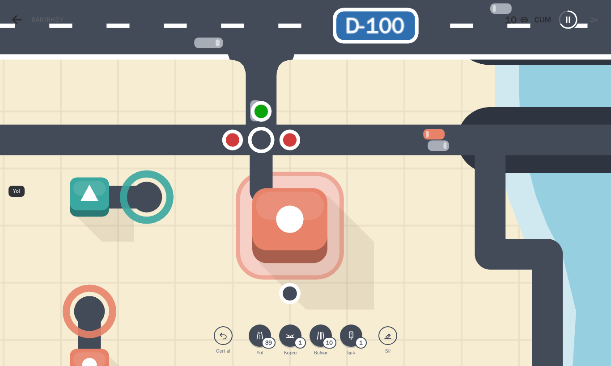
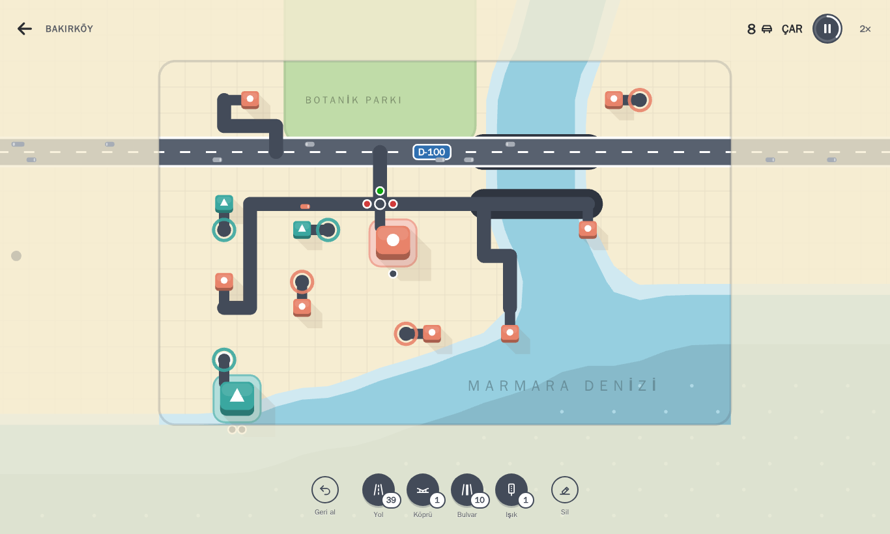
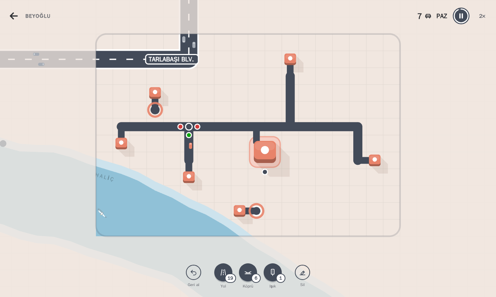
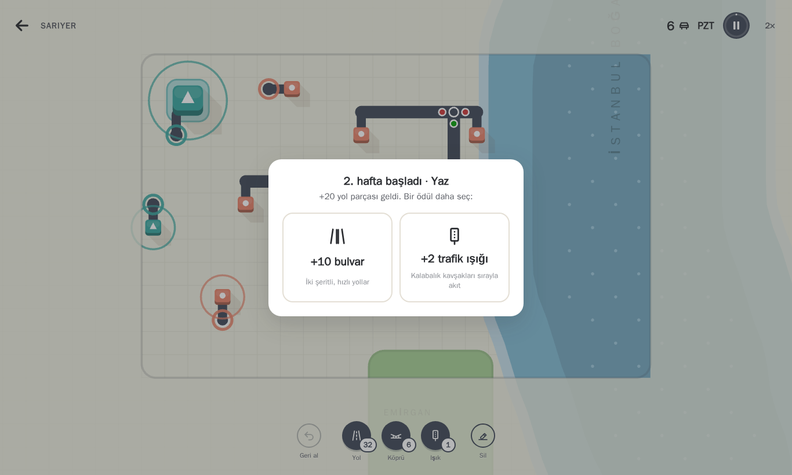
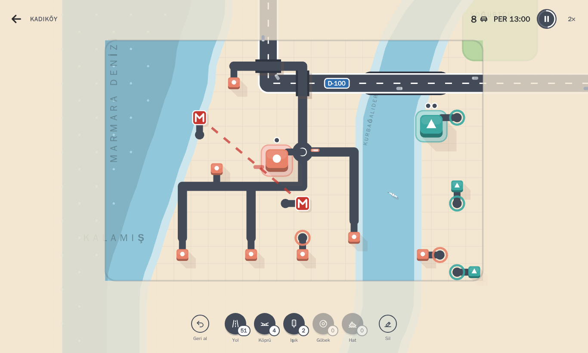
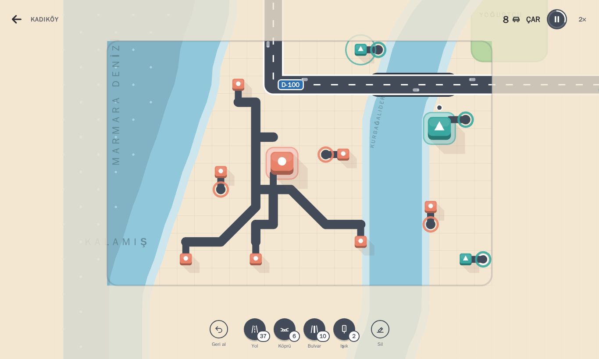
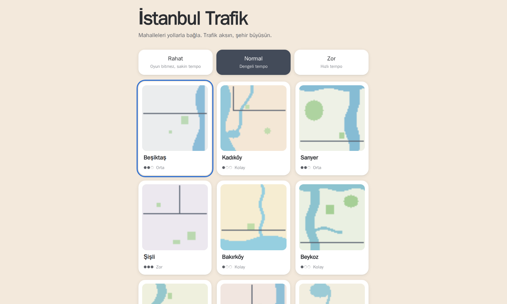

# İstanbul Trafik

İstanbul ilçelerinde yol ağı kurup büyüyen trafiği yönettiğiniz, tarayıcıda çalışan 2D trafik
simülasyonu ve şehir planlama oyunu.

> ### ▶ Sadece oynamak mı istiyorsunuz?
>
> Hiçbir şey kurmanıza gerek yok, oyun tarayıcıda açılır:
> **[alptekinsunnetci.github.io/istanbul-trafik](https://alptekinsunnetci.github.io/istanbul-trafik/)**
>
> Bilgisayarda ve telefonda çalışır. Aşağıdaki kurulum adımları yalnızca projeyi geliştirmek veya
> kendi sunucunuzda yayınlamak isteyenler içindir.

Her iş yerinin bir rengi ve sembolü vardır; aynı renkteki evlerden arabalar oraya gider. Oyuncu
evleri iş yerlerine yolla bağlar. İş yerlerinde bekleyen yolculuklar (raptiyeler) birikir; biri
taşarsa çevresindeki kırmızı halka dolar ve halka tamamen dolunca oyun biter. Skor, tamamlanan
yolculuk sayısıdır. Her hafta yeni yol parçaları gelir ve iki ödülden biri seçilir; şehir büyüdükçe
yeni renkler eklenir.

- **Haritalar (12 ilçe):** Beşiktaş, Kadıköy, Sarıyer, Şişli, Bakırköy, Beykoz, Üsküdar, Beyoğlu,
  Başakşehir, Maltepe, Fatih ve Bağcılar. Her biri ilçenin kıyı, dere, baraj, orman ve otoyol düzenini
  sadeleştirilmiş, özgün bir ızgarada yorumlar; binalar gerçek mahalle adlarını taşır.
- **Sunucu gerekmez:** Oyun tamamen istemci tarafında çalışır. Statik dosya sunan herhangi bir
  web sunucusu (Nginx) yeterlidir. Harici API, CDN, hesap veya telemetri yoktur.

## Oyunda neler var?

- **Hazır otoyollar ve şehir dışı trafiği:** D-100 (E-5), O-1, Atatürk Bulvarı ve Büyükdere Caddesi
  haritada hazırdır, hızlıdır ve silinemez. Harita kenarından gri araçlar gelir: çoğu şehirden geçip
  gider, bir kısmı otoyola bağladığın ev ve iş yerlerine girer, bir kısmı da iş yerlerinden çıkıp
  otoyola katılır. Skora sayılmazlar ama yolları doldururlar.
- **Çapraz yollar:** Çapraz sürüklediğin yol 45° düz bir yol olarak kurulur; araçlar da çaprazdan
  gider ve yol gerçekten kısalır. Çapraz bir adım, düz bir adım kadar (1 yol parçası) tutar.
- **Vapur ve metro hatları:** Hat aracıyla iki yer arasında sürükle: su üstünden geçen hat vapur
  (iki iskele), karadaki hat metro (iki istasyon) olur. Hattın bir ucuna yürüme mesafesindeki evlerin
  yolcuları arabaya binmez, yürür; vapur ya da metro tarifeyle (vapur 15 sn, metro 8 sn arayla) gelir ve
  hepsini birlikte indirir. Karşı durakta aynı iş yerine giden 3 ve daha fazla yolcu tek bir
  **otobüse**, diğerleri birer **taksiye** biner: otobüs trafiği azaltır, taksiler durak çevresini
  doldurur. Otobüs, taşıdığı her yolcu için puan getirir. Yolda ya da durakta bekleyen yolcular iş
  yerinin raptiyelerinde sayılır.
- **Göbekli kavşak:** Göbek aracıyla bir kavşağa dokun: araçlar durmadan, yavaşlayarak girer ve adanın
  çevresinden döner. Yoğun bir kavşakta yol vermeli kavşaktan hızlıdır.
- **Günün saati:** Her gün 06:00'da başlar; sabah ve akşam iş saatlerinde yolculuk artar, gece azalır ve
  harita kararır. Saat üst çubukta görünür.
- **Olaylar:** 3. haftadan sonra ara ara maç günü (bir iş yerine akın), yağmur (tüm araçlar yavaşlar)
  ya da yol çalışması (bir yol bir süre kapalı) olur.
- **Başarımlar ve günün haritası:** 17 başarım (ilk köprü, ilk üst geçit, 10 martı …) menüden
  izlenir. Günün haritası herkes için aynı ilçe ve aynı tohumdur, her gün değişir; sonucu "Paylaş" ile
  paylaşabilirsin.
- **Araçlar:** Otomobil, taksi (sarı tepe lambası), dolmuş (beyaz tavan) ve otobüs ayrı görünür.
- **Müzik ve çevrimdışı oyun:** Hicaz makamında sakin, tarayıcıda üretilen bir arka plan müziği
  (ayarlardan açılıp kısılır). Oyun bir kez açıldıktan sonra internetsiz de çalışır ve telefona
  uygulama gibi eklenebilir.
- **Otoyol kavşakları ve üst geçit:** Yolunu otoyolun üstünde bitirirsen ya da orada dönersen otoyola
  bağlanır: kavşakta katılma ve ayrılma şeritleri vardır, ana yol önceliklidir. Sağa dönüp katılan araç
  yalnızca katılacağı şeritte araç gelirken bekler. Otoyolun üstünden düz geçen yol ise kavşak yapmadan
  **üst geçit** olur (1 köprü parçası); iki yolun trafiği birbirini hiç beklemez.
- **Trafik ışıkları:** Işık aracını seçip bir kavşağa dokun. Kuzey–güney ve doğu–batı yönleri sırayla
  yeşil yanar, bekleyen olmayan yönde erken döner; sola dönmeyi bekleyen araçlar varsa onlara ayrı,
  korumalı bir faz verilir (lambada beyaz nokta). Işıksız kavşakta çapraz trafik varken sürücüler
  yavaşlayıp yol verir; yoğun kavşakta ışık bu yüzden belirgin şekilde hızlıdır.
- **Dereler ve karşı kıyılar:** Kurbağalıdere, Ayamama Deresi, Haliç ve Boğaz (Beşiktaş'ta Anadolu,
  Üsküdar'da Avrupa yakası) haritayı parçalara ayırır. Şehir karşı kıyıda da büyür, oraya köprüyle
  ulaşırsın. Suyu olmayan Şişli'de köprüler üst geçit için kullanılır.
- **Mevsimler:** Her hafta mevsim değişir (ilkbahar, yaz, sonbahar, kış); zemin, park ve su renkleri
  mevsime göre döner. Dereler ve kıyılar adlarıyla yazılır, deniz adları alan oraya ulaşmadan görünür.
- **Haftalık ödüller:** +15 yol, +5 köprü, +10 bulvar, +2 trafik ışığı, +2 göbek ya da +1 vapur/metro
  hattı.
- **Şehir hayatı:** D-100 ve O-1'de belli aralıklarla kendi şeridinde metrobüs geçer. Boğaz'ın ve
  denizin üstünde ara ara martılar uçar ve öter; martıya dokunursan +2 yol parçası kazanırsın. Trafik
  çok sıkışınca kornalar duyulur, ama sınırlıdır: birkaç kez çalar, sıkışıklık geçene kadar susar.
- **Kolay başlangıç:** Rahat / Normal / Zor modları, isteğe bağlı rehberli öğretici, geri al, büyüyen
  oyun alanı ve tek seferlik ipuçları.

## Ekran görüntüleri



| Otoyol kavşağı ve trafik ışığı                                                             | Bakırköy: D-100, Ayamama Deresi, Marmara                                    |
| ------------------------------------------------------------------------------------------ | --------------------------------------------------------------------------- |
|  |  |

| Beyoğlu: Haliç üstünde bir martı ve ışıklı kavşak                              | Sarıyer: Boğaz ve mevsimle gelen haftalık ödül                           |
| ------------------------------------------------------------------------------ | ------------------------------------------------------------------------ |
|  |  |

| Kadıköy: metro hattı, göbekli kavşak, martı ve saat                                                        |
| ---------------------------------------------------------------------------------------------------------- |
|  |

| Kadıköy: çapraz yollar, Kurbağalıdere ve D-100                               |
| ---------------------------------------------------------------------------- |
|  |

| Ana menü: 12 ilçe                                                                |
| -------------------------------------------------------------------------------- |
|  |

## Gereksinimler

Önerilen yol **yalnızca Docker** kullanmaktır; ana makineye Node.js kurmanız gerekmez.

| Araç                           | Sürüm                                               | Not                                                      |
| ------------------------------ | --------------------------------------------------- | -------------------------------------------------------- |
| Docker Engine / Docker Desktop | 24+ (Compose v2 ile)                                | Tüm geliştirme, test ve derleme container içinde çalışır |
| Node.js (isteğe bağlı)         | 22.12+ (container: 22.23.3)                         | Yalnızca Docker'sız çalışmak isterseniz                  |
| npm (isteğe bağlı)             | 10+                                                 | `package-lock.json` ile sabitlenmiş bağımlılıklar        |
| Tarayıcı                       | WebGL destekli güncel Chrome, Edge, Firefox, Safari | Mobil/tablet temel düzeyde desteklenir                   |

## Hızlı başlangıç (Docker)

```bash
# Üretim sürümünü derle ve çalıştır (typecheck + lint + testler imaj içinde çalışır)
docker compose up -d --build web
# → http://localhost:8080
```

## Geliştirme (Docker)

`dev` servisi kaynak klasörünü bağlar; `node_modules` Linux'a özgü olduğu için adlandırılmış bir
Docker biriminde tutulur.

```bash
docker compose run --rm dev npm ci              # bağımlılıkları kur (ilk sefer)
docker compose --profile dev up dev             # Vite geliştirme sunucusu → http://localhost:5173
docker compose run --rm dev npm run typecheck   # TypeScript (strict)
docker compose run --rm dev npm run lint        # ESLint
docker compose run --rm dev npm test            # birim + entegrasyon testleri (Vitest)
docker compose run --rm dev npm run check       # typecheck + lint + biçim + testler
docker compose run --rm dev npm run build       # üretim derlemesi → dist/
docker compose run --rm dev npm run bench       # 15 dakikalık, ~500 araçlı kararlılık/performans testi
docker compose run --rm e2e                     # Playwright tarayıcı testleri (Chromium + mobil)
```

Tarayıcı testleri, sürüm uyumlu Playwright imajında (`mcr.microsoft.com/playwright:v1.63.0-noble`)
çalışır; tarayıcı kurulumu gerekmez. Çalışan bir yayına karşı test etmek için:

```bash
docker compose up -d web
docker run --rm --network istanbul-trafik_default -e E2E_BASE_URL=http://web \
  -v "$PWD:/app" -v istanbul-trafik_e2e_node_modules:/app/node_modules -w /app --ipc=host \
  mcr.microsoft.com/playwright:v1.63.0-noble npx playwright test
```

> Windows'ta Docker Desktop bind mount'larında dosya izleme olaylarını iletmediği için `dev`
> servisi `VITE_USE_POLLING=true` ile çalışır.

## Docker'sız çalışma (isteğe bağlı)

```bash
npm ci
npm run dev          # http://localhost:5173
npm run check
npm run build
npm run preview      # derlenmiş dist/ → http://localhost:4173
npx playwright install --with-deps chromium   # bir kez: tarayıcı ikilisi
npm run test:e2e
```

## Paket komutları

| Komut                     | Açıklama                                                |
| ------------------------- | ------------------------------------------------------- |
| `dev`                     | Vite geliştirme sunucusu                                |
| `build`                   | Üretim derlemesi (`dist/`)                              |
| `preview`                 | `dist/` klasörünü yerelde sunar                         |
| `typecheck`               | `tsc --noEmit` (strict, `noUncheckedIndexedAccess`)     |
| `lint`                    | ESLint (tip bilgili kurallar)                           |
| `format` / `format:check` | Prettier                                                |
| `test` / `test:watch`     | Vitest birim + entegrasyon testleri                     |
| `test:e2e`                | Playwright tarayıcı testleri                            |
| `bench`                   | Performans/kararlılık testi ve 12 ilçede denge botu     |
| `check`                   | typecheck + lint + biçim + test                         |
| `build:prod`              | `check` başarılıysa `build`                             |
| `licenses`                | `docs/THIRD_PARTY_LICENSES.md` dosyasını yeniden üretir |

## Nasıl oynanır?

| Kontrol                                    | İşlev                                              |
| ------------------------------------------ | -------------------------------------------------- |
| Binadan başlayıp diğer binaya sürükle      | Yol çiz; uçlar binaların girişine yapışır          |
| Çapraz sürükle                             | 45° çapraz yol                                     |
| Geri al düğmesi, `Ctrl+Z`                  | Son çizimi geri al, parçalar geri gelir            |
| Sil düğmesi ya da sağ tık + sürükle        | Yolu sil, parçalar geri gelir                      |
| Işık düğmesi, sonra kavşağa dokun          | Trafik ışığı koy; tekrar dokununca kalkar          |
| Göbek düğmesi, sonra kavşağa dokun         | Göbekli kavşak koy; tekrar dokununca kalkar        |
| Hat düğmesi, iki yer arasında sürükle      | Vapur ya da metro hattı; durağa dokununca kalkar   |
| Araca veya binaya dokunma                  | Ayrıntıları göster                                 |
| Uçan martıya dokunma                       | +2 yol parçası                                     |
| Tekerlek, `+` / `−`, iki parmakla kıstırma | Yakınlaştır / uzaklaştır                           |
| Orta tık + sürükle, `W A S D`, iki parmak  | Haritayı kaydır                                    |
| `Boşluk`                                   | Duraklat / devam                                   |
| `1` … `6`                                  | Yol · Bulvar · Silgi · Işık · Göbek · Hat          |
| `T` · `I` · `F`                            | Trafik katmanı · İstatistikler · Haritayı sığdır   |
| `Esc` veya ←                               | Menü (istatistik, yeniden başlat, ayarlar, yardım) |

- **Parçalar:** Her kara hücresi 1 yol parçası, her su hücresi ve her üst geçit 1 köprü parçası kullanır.
  Bulvar (iki şeritli, hızlı yol) mevcut yolun üstüne çizilir ve hücre başına 1 bulvar parçası kullanır.
  6 köprü, 2 trafik ışığı, 1 göbek ve 1 vapur/metro hattıyla başlanır.
- Her hafta (90 sn) +20 yol parçası gelir ve iki ödülden biri seçilir (+15 yol, +5 köprü, +10 bulvar,
  +2 trafik ışığı). Oyun seçim yapılana kadar bekler.
- **Su ve köprüler:** Dereler (Kurbağalıdere, Ayamama, Göksu, Sazlıdere), Haliç ve Boğaz'ın karşı
  kıyıları haritayı parçalara ayırır. İlk mahalle hep tek kıyıda başlar; 2. haftadan sonra bazı binalar
  karşı kıyıda çıkar ve oraya köprüyle ulaşılır.
- **Hazır otoyollar:** D-100 (E-5), O-1, O-2, O-4, TEM, Basın Ekspres, Atatürk ve Tarlabaşı bulvarları,
  Büyükdere Caddesi haritada hazırdır. Bunlar
  hızlıdır (90 km/sa) ve silinemez. Harita kenarından gelen gri araçların çoğu şehirden geçip gider; bir
  kısmı otoyola bağladığın ev ve iş yerlerine girer, bir kısmı da iş yerlerinden çıkıp otoyola katılır.
  Bu araçlar skora ve raptiyelere sayılmaz, ama yolları doldurur.
- **Trafik ışığı:** Işıksız kavşakta karşı yönden araç gelirse sürücüler yavaşlayıp yol verir. Işık
  kuzey–güney ve doğu–batı yönlerine sırayla yeşil yakar, bekleyen olmayan yönde erken döner ve sola
  dönmeyi bekleyenlere ayrı bir faz verir. Işık kaldırılınca ya da kavşak silinince parçası geri gelir.
- **Üst geçit:** Otoyolun üstünden düz geçen yol kavşak yerine üst geçit olur (1 köprü parçası). Otoyola
  bağlanmak için yolu otoyolun üstünde bitir ya da orada dön.
- **Zorluk:** Rahat (oyun bitmez, sakin tempo), Normal (varsayılan) ve Zor. Seçim hatırlanır; en iyi
  skorlar ilçe ve mod başına ayrı tutulur.
- **Oynayarak öğren:** Menüdeki rehberli oyun 7 adımda anlatır (yol çiz, ilk araba, diğer evler, geri
  al, trafik ışığı, otoyol ve üst geçit, köprü); saat ilk yol bağlanana kadar bekler.
- **Büyüyen alan:** Oyun küçük bir alanla başlar (dikey ekranda dikey), her hafta genişler; kamera
  alanı kendiliğinden sığdırır, kaydırma ve yakınlaştırma isteğe bağlıdır.
- Aynı **harita tohumu** aynı başlangıç haritasını ve trafik akışını üretir.

## Mimari özeti

Ayrıntılar: [ARCHITECTURE.md](ARCHITECTURE.md).

```
src/core       sabitler, deterministik PRNG, olay yolu, sabit adımlı simülasyon
src/map        ızgara, yol düzenleyici, topoloji → yönlü yol grafiği, geometri, ilçeler
src/traffic    araç modeli, IDM takip, şerit değiştirme, kavşak rezervasyonu, A* rota, talep, kuyruk
src/gameplay   oturum, skor/memnuniyet, zorluk, oyun sonu, kayıt anlık görüntüsü
src/persistence  sürümlü kayıt şeması, doğrulama, göç, localStorage yöneticisi
src/rendering  PixiJS çizimi (salt okuma): zemin, yollar, binalar, araçlar, efektler, kamera
src/ui         DOM arayüzü: HUD, araç çubuğu, menüler, ayarlar, istatistik, girdi
src/app        giriş noktası, durum makinesi, oyun döngüsü, denetleyici, ses
```

Simülasyon çekirdeği (`core`, `map`, `traffic`, `gameplay`, `persistence`) PixiJS'e ve DOM'a bağımlı
değildir. Bu sınır ESLint kuralıyla zorlanır.

## Kayıtlar

Ayarlar, en iyi skorlar, son 20 oyunun özeti ve devam edilebilir aktif oyun yalnızca tarayıcının
`localStorage` alanında tutulur. **Sunucuya yedeklenmez**; tarayıcı/site verileri silinirse kaybolur.
Bozuk veya uyumsuz kayıtlar uygulamayı çökertmez: güvenli varsayılanlara dönülür ve kullanıcıya bildirilir.

## Lisans

Kaynak kod: [LICENSE](LICENSE). Üçüncü taraf paketler: [docs/THIRD_PARTY_LICENSES.md](docs/THIRD_PARTY_LICENSES.md).
Tüm oyun görselleri ve sesleri kodla üretilir; harici varlık kullanılmaz.
